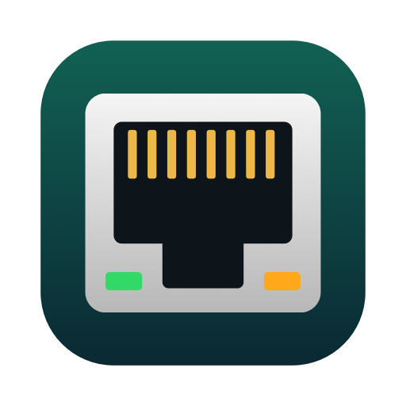
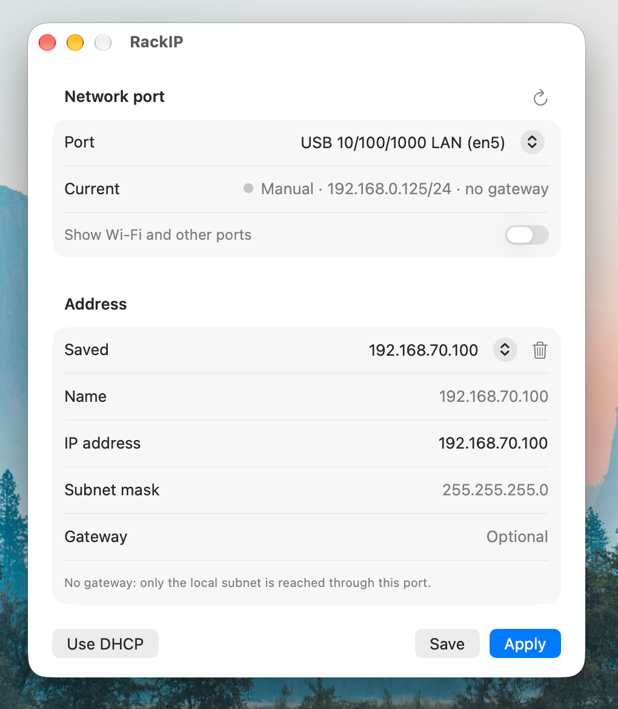

<p align="center">
  
</p>

<h1 align="center">RackIP</h1>

<p align="center">
  Switch your Ethernet port's IP address in one click.<br>
  Made for data center work: plug into a server, pick its address, apply.
</p>

<p align="center">
  <a href="https://github.com/majnioui/RackIP/releases/latest"><b>Download</b></a>
  &nbsp;·&nbsp; macOS &nbsp;·&nbsp; Windows &nbsp;·&nbsp; Linux &nbsp;·&nbsp; Free and open source
</p>

<p align="center">
  
</p>

---

When you plug a laptop into a server's management or service port, your
laptop needs an address on that server's subnet. Normally that means digging
through the network settings (on macOS: System Settings › Network › adapter
› Details › TCP/IP › Manually) every time you move to another server.

RackIP turns this into a small window: choose the port, type or pick the
address, press **Apply**.

## Features

- **Port picker**: lists your wired adapters (built-in, USB, Thunderbolt,
  docks) with a live *connected* indicator, so you can tell which dongle has
  the cable.
- **Static IP in one step**: the IP address is required. Subnet mask and gateway are
  optional (the mask defaults to `255.255.255.0`). CIDR works too
  (`10.0.0.5/24`), and the mask field takes a prefix (`22` or `/22`).
- **Saved addresses**: every address you apply is saved, named after its IP
  unless you name it ("iDRAC rack 12"). Next time you're at that server, pick
  it from the dropdown.
- **Back to DHCP**: one button.
- **Input checks**: rejects bad addresses, invalid masks, and
  network/broadcast addresses. Warns when the gateway is outside the subnet.
- **Menu bar** (macOS): apply any saved address without opening the window.

> **Tip:** leave the gateway empty while you work on an isolated management
> network. Your internet traffic then stays on Wi-Fi, and only the server's
> subnet goes through the cable.

## Download

Get the latest version from
[Releases](https://github.com/majnioui/RackIP/releases/latest).

| Platform | File | Notes |
|----------|------|-------|
| macOS 13+ (Apple Silicon and Intel) | `RackIP-x.y.z.dmg` | Open it and drag RackIP to Applications. |
| Windows 10/11 (64-bit) | `RackIP-x.y.z-windows-x64.exe` | Single portable exe, no installer. Asks for administrator rights at launch, which Windows needs to change addresses. |
| Linux (x86_64) | `RackIP-x.y.z-linux-x86_64.AppImage` | `chmod +x` and run. Needs NetworkManager, which most desktop distributions include. A `.tar.gz` is also available. |

## How it works

RackIP uses each system's own network tools, so every change also shows up in
the normal network settings:

| | macOS | Windows | Linux |
|---|---|---|---|
| Static IP | `networksetup -setmanual` | `netsh interface ipv4 set address … source=static` | `nmcli` connection profile "RackIP *device*" |
| DHCP | `networksetup -setdhcp` | `netsh … source=dhcp` | removes that profile and reconnects |
| Permissions | none on admin accounts, otherwise a password prompt | administrator (UAC prompt at launch) | NetworkManager's usual policy, usually no prompt for the logged-in user |

On Linux, RackIP never edits your existing connection profiles. It creates its
own profile per device and removes it when you switch back to DHCP.

## Build from source

**macOS** (Swift, Command Line Tools are enough):

```sh
scripts/bundle.sh           # build/RackIP.app (universal)
scripts/dmg.sh              # build/RackIP-<version>.dmg
swift run core-checks       # validation + parsing checks
```

**Windows / Linux** (Rust):

```sh
cd windows-linux
cargo build --release       # target/release/rackip(.exe)
cargo test
cargo run -- --list         # print detected ports
```

On Linux, building needs the X11/Wayland headers:
`sudo apt install libxkbcommon-dev libxcb-render0-dev libxcb-shape0-dev libxcb-xfixes0-dev libgl1-mesa-dev libwayland-dev`.

Pushing a `v*` tag builds all three platforms with GitHub Actions and attaches
them to the release.

### Layout

- `Sources/`: macOS app (SwiftUI, with a menu bar extra).
- `windows-linux/`: Windows and Linux app (Rust, egui).
- `assets/`: icons, generated by `swift scripts/make-icon.swift assets`.

## Roadmap

- **DHCP server mode**: hand out addresses on the selected port, so a device
  that expects DHCP (a factory-reset BMC, switch, PDU or freshly imaged
  server) gets one from your laptop. RackIP shows the lease it took (IP and
  MAC) so you know where to connect. Configurable range and lease time. It
  serves only on the chosen port, stops when you switch modes, and checks for
  an existing DHCP server first so it never competes with a production
  network.

Ideas and requests are welcome in
[Issues](https://github.com/majnioui/RackIP/issues).

## License

MIT
